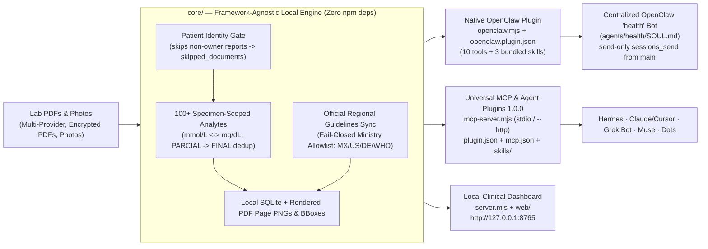

# Health Timeline Bot

> *"Kimi K3.1 Pro lets us answer our health questions at the speed that helps us stay calm — because health, and answers about our health, cannot wait."*

## Why I built this

In 2025, I found myself in and out of hospitals carrying a huge folder of bloodwork, ECGs, X-rays, and ultrasounds — flipping between different clinics, different units, and partial updates just trying to understand what was happening. When you are already anxious about your health, scattered PDFs and printouts make every doctor visit harder than it needs to be.

I built **Health Timeline** so anyone navigating an overwhelming medical situation can turn a messy stack of lab reports and photos into one calm, chronological, evidence-backed timeline — and get fast, cited answers they can bring to their physician.

---

**Health Timeline** is a privacy-first personal health timeline, multi-lab biomarker normalizer, official regional guidelines engine, and centralized **OpenClaw `health` bot** (plus portable **MCP + `SKILL.md`** bundle) powered by **Kimi K3.1 Pro on Cerebras**.

Drop lab PDFs or lab photos from different providers into one local inbox. Health Timeline deterministically filters out other people's reports, normalizes units across laboratories, orders results by **collection date** (never receipt/print date), overlays **official regional clinical targets** alongside each lab's own reference range, links every number to an **exact PDF page + bounding-box highlight**, and exposes a centralized **`health` bot** that any OpenClaw chat can consult without exposing raw medical transcripts.

> **Safety & Privacy Notice:** For demonstration and educational purposes only. All checked-in fixtures (`fixtures/`) are 100% synthetic. This tool does **not** provide medical advice, diagnosis, or treatment, and is not a substitute for a qualified healthcare professional. See [PRIVACY.md](PRIVACY.md).

---

## Architecture



---

## Key Capabilities

| Capability | How it works |
|---|---|
| **Strict Patient Identity Gate** | Accent-, case-, and punctuation-normalized matcher (`core/patient_gate.mjs`) with optional DOB/sex corroboration. Non-owner lab reports are cleanly rejected into `skipped_documents` with **0 observations stored**. |
| **Chronological Multi-Lab Normalization** | Orders events by **collection date** (not report/email receipt date), converts units deterministically (`mmol/L → mg/dL`, `µg/dL ↔ ug/dL`, `UI/L ↔ U/L`), disambiguates specimens (`serum:glucose` vs `urine:glucose`), supersedes `PARCIAL` reports when `FINAL` arrives, deduplicates companion summaries while preserving clinical findings, and parses owner-encrypted PDFs seamlessly. |
| **Zero-Local-OCR Photo / Scan VLM Path** | Photos (`.png/.jpg/.webp/.heic`) and scanned PDFs return `{ status: "needs_vlm_extraction", imagePaths, schemaHint }` from `health_import`. The agent reads the image with its native vision capability and commits structured JSON through `health_commit_extracted` (which still enforces the deterministic patient gate & unit normalizer). |
| **Live Official Regional Guidelines** | `health_guidelines_sync` fetches official national ministry/department sources for `MX`, `US`, `DE`, or `GLOBAL` through a **code-enforced domain allowlist** (blocking commercial/unofficial sites like `webmd.com` or `example.com`) and writes a cited `regional-guidelines.md` displayed alongside each lab's own assay range. |
| **Exact Visual Evidence** | Every plotted measurement stores page number, verbatim excerpt, and normalized bounding box `[left, top, width, height]` so clicking any point opens the exact source PDF page with a yellow highlight (`/?obs=<id>#evidence`). |
| **Centralized `health` Bot + Cross-Agent Portability** | Dedicated `health` OpenClaw agent (`agents/health/`) receives read-only consultations from `main` or any channel via `sessions_send` (`tools.sessions.visibility: "agent"`, `send: []` on `health` so transcripts stay private). The exact same 10 tools and 3 `SKILL.md` skills also run via `mcp-server.mjs` (stdio or Streamable HTTP) and Agent Plugins 1.0.0 (`plugin.json` + `mcp.json`). |

---

## Zero-to-Running Quickstart

**Requirements:** Node.js `>= 22.16` (uses built-in `node:sqlite`, **zero npm dependencies**), Python 3 (`pypdf`/`pdfplumber` or Poppler `pdftotext`/`pdftoppm`).

### 1. Run the Synthetic Demo Dashboard Locally

```bash
git clone https://github.com/uncrayon/health-timeline-bot.git
cd health-timeline-bot

# Ingest the checked-in synthetic fixtures (Cedar Lab + Meridian Diagnostics)
npm run ingest:demo

# Launch the loopback dashboard on http://127.0.0.1:8765
npm start
```

Open **http://127.0.0.1:8765** to explore the cross-lab LDL trend (`112 mg/dL` on Feb 14, 2026 → `3.60 mmol/L` = `139.2 mg/dL` on Oct 8, 2026, `+27.2 mg/dL`), click any point to inspect the highlighted PDF evidence, or test **+ Upload PDF / Photo**.

### 2. Install as a Native OpenClaw Plugin + Centralized `health` Bot

```bash
# Link the plugin (registers 10 health_* tools + bundles 3 SKILL.md skills)
openclaw plugins install --link .
openclaw plugins inspect health-timeline --runtime --json
```

Use [agents/health/openclaw.health-bot.example.json](agents/health/openclaw.health-bot.example.json) (validated with `openclaw config validate`) to register the dedicated `health` agent with privacy-preserving `main → health` send-only `agentToAgent` routing.

### 3. Power It with Kimi K3.1 Pro on Cerebras

Configure your Cerebras API key in `~/.openclaw/.env` (or environment) and select **Kimi K3.1 Pro on Cerebras**:

```bash
export CEREBRAS_API_KEY="<your-cerebras-key>"
openclaw models set cerebras/moonshotai-kimi-k3.1-pro-trial

# Ask your centralized health bot directly
openclaw agent --agent health --message "What changed in my LDL cholesterol across labs? Cite exact PDF pages and official regional targets."

# Or ask from your main chat — main delegates to health via sessions_send
openclaw agent --agent main --message "Check with my health bot whether my cholesterol went up."
```

#### Measured Speed: Kimi K3.1 Pro on Cerebras vs Carbon 4

On the identical multi-lab tool context (LDL + fasting glucose trends across providers, official MX guidelines, and patient-gate skip check — 100% synthetic data):

| Model / Engine | Measured Throughput | Latency (equivalent multi-lab answer) | Speedup |
|---|---:|---:|---:|
| **Kimi K3.1 Pro on Cerebras WSE** (`moonshotai-kimi-k3.1-pro-trial`) | **266.7 – 308.5 tok/s** | **3.5s** (`900` tok) | **4.7× faster** |
| **Carbon 4** (`google/gemini-4-carbon`) | **65.2 tok/s** | **11.1s** (`721` tok) | `1.0×` baseline |

### 4. Use in Any Other Agent (Hermes, Claude/Cursor, Grok Bot, Muse, Dots)

```bash
# Stdio MCP server (default)
npm run mcp

# Streamable HTTP MCP server
node mcp-server.mjs --http --port 8766
```

`plugin.json`, `mcp.json`, and `skills/*/SKILL.md` conform to **Agent Plugins 1.0.0** and **`agentskills.io`**, exposing all 10 tools, 2 resources (`health://regional-guidelines.md`, `health://overview.json`), and 3 skills:
- [`skills/health-onboarding-guidelines/SKILL.md`](skills/health-onboarding-guidelines/SKILL.md) — interactive patient onboarding + official regional guidelines sync
- [`skills/health-clinical-context/SKILL.md`](skills/health-clinical-context/SKILL.md) — always-consult clinical context, dual lab/regional citations, non-diagnostic guardrails
- [`skills/health-timeline-ingest/SKILL.md`](skills/health-timeline-ingest/SKILL.md) — deterministic PDF ingestion + VLM photo/scan extraction workflow

---

## Verification

```bash
# Run full automated suite (synthetic fixtures, patient gate, analytes, VLM photo flow,
# PARCIAL->FINAL & companion summary deduplication, footer noise filter,
# official guidelines allowlist for MX/US/DE, OpenClaw plugin & health-bot config,
# MCP stdio JSON-RPC, and dashboard HTTP + path-traversal rejection)
npm test

# Backward-compatible OpenClaw tool contract test (requires `npm run ingest:demo`)
node --test verify_tool.mjs
```

---

## Privacy & Security Boundaries

- **Zero real health data in this repository:** Only two synthetic PDFs (`fixtures/cedar-lab.pdf`, `fixtures/meridian-diagnostics.pdf`) are checked in. Runtime databases, private inboxes, and `.env` secrets are gitignored and stored strictly outside the repo.
- **Loopback-only by default:** Both `server.mjs` (`127.0.0.1:8765`) and OpenClaw Gateway (`127.0.0.1:18789`) bind to localhost; access remote cloud VMs exclusively over SSH port forwarding (`-L 8765:127.0.0.1:8765 -L 18789:127.0.0.1:18789`).
- **Path-traversal & domain-allowlist enforcement:** `/evidence/*` and `POST /api/upload` enforce `realpath`-confined roots, and `core/guidelines.mjs` enforces a fail-closed official health ministry hostname allowlist in code.
- See [PRIVACY.md](PRIVACY.md) for full details.
